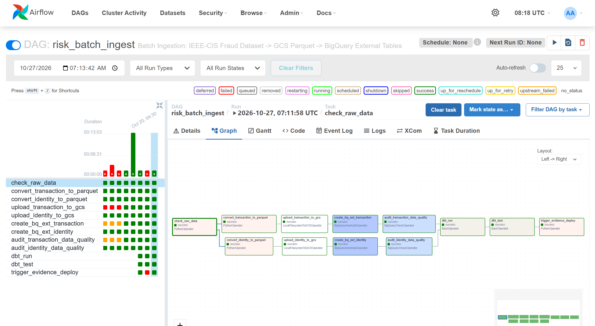
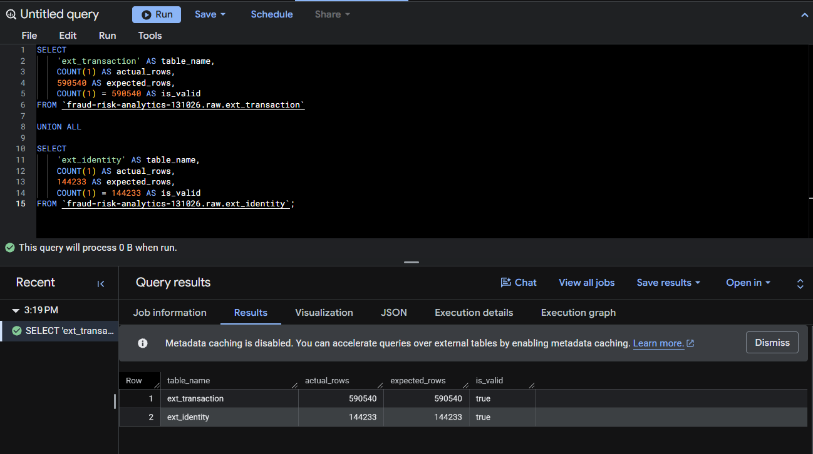
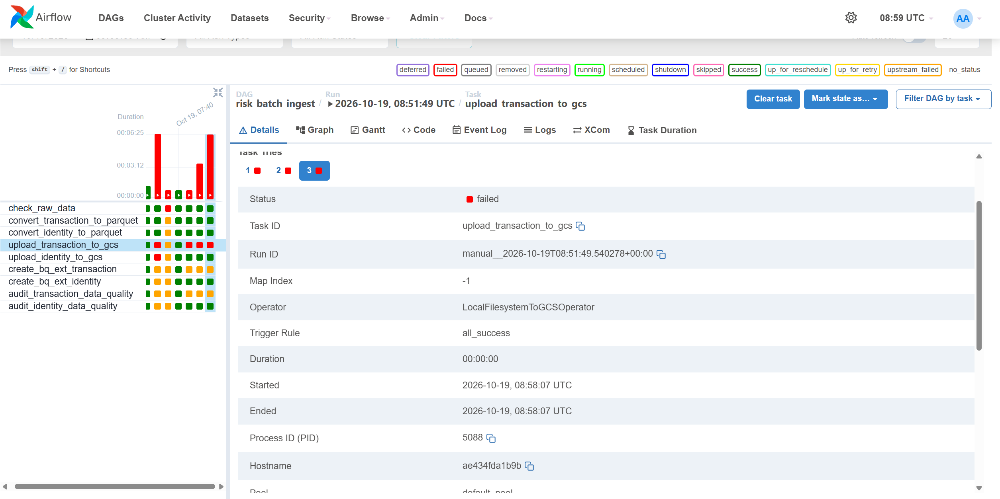
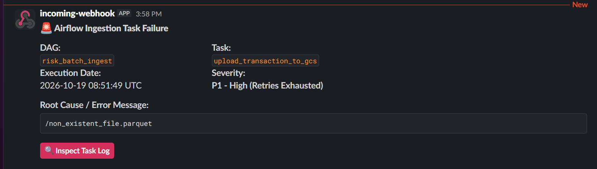
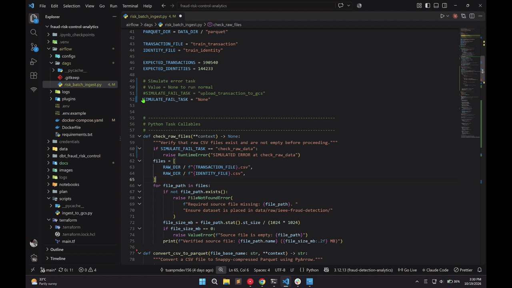

# Financial Fraud Detection & Risk Analytics


📊 **Live BI Dashboard (GitHub Pages)**: [https://tuanpmdev156.github.io/fraud-risk-control-analytics/](https://tuanpmdev156.github.io/fraud-risk-control-analytics/)

---

## 1. Problem Statement

This project builds a production-grade **end-to-end Data Engineering system** for financial fraud detection and risk analytics, featuring:

- **Automated End-to-End Pipeline**: 
Orchestration via *Apache Airflow* covering raw CSV validation, Parquet compression, GCS & BigQuery External Table provisioning, *dbt* transformations/testing, and *GitHub Actions* BI deployment with *Slack* incident alerting

- **Optimized Medallion Data Warehouse**: 
Multi-layer architecture (`raw`, `staging`, `production`) on BigQuery with partitioning, clustering, deduplication, and quarantine routing

- **Resilience & Data Governance**: 
Engineered to handle job interruptions, schema drift, duplicate primary keys, and anomalous records via PyArrow & dbt tests

- **BI-as-Code Dashboard & CI/CD**: 
Interactive risk analytics built with Evidence.dev (Markdown + SQL) and automatically deployed to GitHub Pages via GitHub Actions (`push` & Airflow `workflow_dispatch`)

---

## 2. Dataset & Exploratory Data Analysis (EDA)

The project utilizes the benchmark **IEEE-CIS Fraud Detection** dataset ([Kaggle](https://www.kaggle.com/c/ieee-fraud-detection)):
- **Data Volume**: 590,540 transactions and 144,233 identity records.

- **Conversion Efficiency**: Compressed raw CSVs (710 MB) into Parquet (83.6 MB, **~88% space saving**) using Snappy.

- **Key EDA Findings**: Severe class imbalance, heavy amount right-skewness.

- **Data warehouse Architecture**: Pruned 400+ raw columns down to **18–23 core attributes** (~95.8% memory reduction), partitioned by `transaction_date` and clustered by `product_code`, `card_network`, `is_fraud`.

> Detailed EDA & Architectural Decision: [`docs/data_exploration.md`](docs/data_exploration.md)  
Standardized Profiling Notebook: [`notebooks/data_exploration.ipynb`](notebooks/data_exploration.ipynb)

---

## 3. System Architecture

---

## 🛠️ Tech Stack

| Component | Technology | Rationale |
|---|---|---|
| **Cloud** | Google Cloud Platform | BigQuery serverless DW + native GCS Data Lake integration |
| **IaC** | Terraform | Declarative infra: GCS, BigQuery datasets (`raw`, `staging`, `production`), IAM |
| **Python Env** | `uv` (Astral) | 10–100x faster than pip, deterministic lockfile (`uv.lock`) |
| **Batch Orchestration** | Apache Airflow 2.11 (Docker) | Automated DAG management with auto-retry, DQ gates & Slack webhook alerting |
| **Transformation** | dbt-core + dbt-bigquery | Modular SQL ELT with custom macros, schema/singular testing & lineage |
| **DW Design** | Medallion (`raw`→`staging`→`production`) | Partitioned by `transaction_date`, clustered by `product_code`, `card_network`, `is_fraud` |
| **BI Dashboard** | Evidence.dev (BI-as-Code) | Version-controlled Markdown + SQL analytics with static site generation |
| **CI/CD** | GitHub Actions | Automated BigQuery source extraction, static build & GitHub Pages deployment |

---

## 🔧 Quick Start & Reproduction Guide

### Prerequisites

- [Google Cloud SDK](https://cloud.google.com/sdk/docs/install) (`gcloud`)
- [Terraform](https://developer.hashicorp.com/terraform/install) (>= 1.0)
- [Docker Desktop](https://www.docker.com/products/docker-desktop/)
- [uv](https://docs.astral.sh/uv/getting-started/installation/) (Python package manager)
- [Node.js](https://nodejs.org/) (>= 18.0, for Evidence.dev dashboard)

### 1. Clone & Install Dependencies

```bash
git clone https://github.com/tuanpmdev156/fraud-risk-control-analytics.git
cd fraud-risk-control-analytics
uv sync
```

### 2. GCP Authentication

```bash
gcloud auth login
gcloud auth application-default login
```

### 3. Provision Infrastructure (Terraform)

```bash
cd terraform
# Edit terraform.tfvars with your GCP project ID and bucket name

terraform init
terraform plan
terraform apply
cd ..
```

### 4. Verify Infrastructure

```bash
terraform -chdir=terraform output
gcloud storage ls
bq ls --project_id=YOUR_PROJECT_ID
```

### 5. Data Exploration & Validation

Inspect distributions, label imbalance, and schema integrity:
- **Notebook**: [`notebooks/data_exploration.ipynb`](notebooks/data_exploration.ipynb) (numerical profiling & memory benchmarks)
- **Exploratory Data Analysis**: [`docs/data_exploration.md`](docs/data_exploration.md)
```bash
uv run jupyter lab notebooks/data_exploration.ipynb
```

### 6. Standalone Ingestion to GCS Data Lake

Run [`scripts/ingest_to_gcs.py`](scripts/ingest_to_gcs.py) to convert raw CSVs to Snappy Parquet (**~88% compression**) and upload to GCS:

```bash
# Standard execution (Convert CSV -> Parquet and upload to GCS)
python scripts/ingest_to_gcs.py

# Optional: upload only / convert only
python scripts/ingest_to_gcs.py --skip-convert  # upload only
python scripts/ingest_to_gcs.py --skip-upload   # convert only
```

Verify uploaded objects in GCS:
```bash
gcloud storage ls gs://YOUR_BUCKET_NAME/raw/ieee_cis/
```

📖 **Full Ingestion Guide, Benchmarks & CLI Options**: [`docs/ingestion_to_gcs.md`](docs/ingestion_to_gcs.md)

---

### 7. Orchestrate End-to-End Pipeline with Apache Airflow

```
┌─────────────────────────────────────────────────────────────────────────────┐
│                   AIRFLOW DAG: risk_batch_ingest (12 Tasks)                 │
├─────────────────────────────────────────────────────────────────────────────┤
│                                                                             │
│                            [ check_raw_data ]                               │
│                                     │                                       │
│                   ┌─────────────────┴─────────────────┐                     │
│                   ▼                                   ▼                     │
│   [ convert_transaction_to_parquet ]   [ convert_identity_to_parquet ]      │
│                   │                                   │                     │
│                   ▼                                   ▼                     │
│     [ upload_transaction_to_gcs ]         [ upload_identity_to_gcs ]        │
│                   │                                   │                     │
│                   ▼                                   ▼                     │
│     [ create_bq_ext_transaction ]         [ create_bq_ext_identity ]        │
│                   │                                   │                     │
│                   ▼                                   ▼                     │
│  [ audit_transaction_data_quality ]     [ audit_identity_data_quality ]     │
│                   │                                   │                     │
│                   └─────────────────┬─────────────────┘                     │
│                                     ▼                                       │
│                               [ dbt_run ]                                   │
│                    (Staging Views & Production Marts)                       │
│                                     │                                       │
│                                     ▼                                       │
│                              [ dbt_test ]                                   │
│                     (15 Schema & Singular DQ Tests)                         │
│                                     │                                       │
│                                     ▼                                       │
│                        [ trigger_evidence_deploy ]                          │
│                  (GitHub Actions workflow_dispatch ──► Pages)               │
│                                                                             │
├─────────────────────────────────────────────────────────────────────────────┤
│   Resilience: Auto-Retry (2x, 3m delay) ──► Slack Incident Alert (Webhook)  │
└─────────────────────────────────────────────────────────────────────────────┘
```

#### Pipeline Overview (12 Tasks)
1. **`check_raw_data`**: Verifies that local raw CSV files (`train_transaction.csv`, `train_identity.csv`) exist and are not empty before downstream execution.

2. **`convert_transaction_to_parquet`**: Converts `train_transaction.csv` to Snappy-compressed Parquet (**~88.3% storage saving**) with PyArrow schema validation.

3. **`convert_identity_to_parquet`**: Converts `train_identity.csv` to Snappy-compressed Parquet (**~85.4% storage saving**) in parallel with transaction conversion.

4. **`upload_transaction_to_gcs`**: Uploads `train_transaction.parquet` into the GCS Data Lake (`gs://<bucket>/raw/ieee_cis/`).

5. **`upload_identity_to_gcs`**: Uploads `train_identity.parquet` into the GCS Data Lake (`gs://<bucket>/raw/ieee_cis/`).

6. **`create_bq_ext_transaction`**: Provisions the `raw.ext_transaction` External Table in BigQuery pointing directly to GCS Parquet.

7. **`create_bq_ext_identity`**: Provisions the `raw.ext_identity` External Table in BigQuery pointing directly to GCS Parquet.

8. **`audit_transaction_data_quality`**: Data Quality gate validating exact transaction row count (**590,540** rows) and primary key integrity (`TransactionID IS NOT NULL`).

9. **`audit_identity_data_quality`**: Data Quality gate validating exact identity row count (**144,233** rows) and primary key integrity (`TransactionID IS NOT NULL`).

10. **`dbt_run`**: Executes all dbt Staging views (`stg_transaction`, `stg_identity`, `stg_quarantined_transaction`) and Production Mart tables (`fct_transaction`, `fraud_risk_summary`).

11. **`dbt_test`**: Runs 15 automated schema (`unique`, `not_null`, `accepted_values`) and singular business assertion tests across staging and mart layers.

12. **`trigger_evidence_deploy`**: Dispatches a `workflow_dispatch` event via the GitHub REST API to trigger `.github/workflows/deploy-evidence.yml`, rebuilding and deploying the Evidence.dev dashboard to GitHub Pages only after all upstream checks and dbt tests succeed.

  
*Figure: Airflow batch ingestion pipeline executing all tasks successfully.*

#### Data Quality & External Table Verification
BigQuery external tables are validated immediately upon ingestion to guarantee data integrity:

  
*Figure: BigQuery SQL audit verifying exact row counts (590,540 transactions, 144,233 identities).*

#### Pipeline Reliability, Schema Drift Protection & Slack Alerts

The batch pipeline is engineered for production resilience:

- **Auto-Retry**: Tasks automatically retry 2 times (spaced 3 minutes apart) to recover from transient network or API errors.
- **Safe Reruns (Idempotent)**: Overwriting objects in GCS and executing `CREATE OR REPLACE EXTERNAL TABLE` in BigQuery guarantees that re-running the DAG never produces duplicate records.
- **Schema Drift Fail-Fast**: PyArrow enforces required column checks (`TransactionID`, `isFraud`, `TransactionAmt`) during conversion prior to GCS upload.
- **Real-time Slack Incident Alerting**: Configured via `on_failure_callback` to dispatch rich Slack alerts containing DAG ID, Task ID, Execution Date, and direct log links upon retry exhaustion.

  
*Figure: Simulated task failure demonstrating auto-retry mechanism before marking as failed.*

  
*Figure: Real-time Slack incident notification with direct link to task logs.*

  
*Figure: End-to-end demonstration of Airflow task auto-retry and real-time Slack incident alerting.*

#### Quick Commands
```bash
# Start Airflow cluster (Postgres, Webserver, Scheduler)
docker compose -f airflow/docker-compose.yaml up -d --build

# View Airflow Web UI
# URL: http://localhost:8080 (Username: admin | Password: admin)

# Unpause and trigger the DAG via CLI or Web UI
docker compose -f airflow/docker-compose.yaml exec airflow-scheduler airflow dags unpause risk_batch_ingest
docker compose -f airflow/docker-compose.yaml exec airflow-scheduler airflow dags trigger risk_batch_ingest
```
---

### 8. Data Warehouse Transformations & Data Quality (dbt)

The [`dbt_fraud_risk_control/`](dbt_fraud_risk_control) project implements a Medallion ELT architecture on BigQuery with built-in deduplication, quarantine routing, and automated testing.

#### Medallion Architecture Models
- **Staging Layer (`staging` — Views)**:
  - [`stg_transaction.sql`](dbt_fraud_risk_control/models/staging/stg_transaction.sql): Prunes 400+ columns to 18 core fields, derives timestamps, buckets amounts via the [`classify_amount`](dbt_fraud_risk_control/macros/classify_amount.sql) macro, and deduplicates by `transaction_id` (`ROW_NUMBER()`).
  - [`stg_identity.sql`](dbt_fraud_risk_control/models/staging/stg_identity.sql): Standardizes identity fields, normalizes OS/browser strings, and deduplicates records.
  - [`stg_quarantined_transaction.sql`](dbt_fraud_risk_control/models/staging/stg_quarantined_transaction.sql): Routes anomalous records (`transaction_amount <= 0` or invalid `is_fraud`) with diagnostic `quarantine_reason` flags.
- **Production Marts (`production` — Partitioned & Clustered Tables)**:
  - [`fct_transaction.sql`](dbt_fraud_risk_control/models/marts/fct_transaction.sql): Enriched transaction fact table joining transaction and identity data. Partitioned by `transaction_date`, clustered by `product_code`, `card_network`, `is_fraud`.
  - [`fraud_risk_summary.sql`](dbt_fraud_risk_control/models/marts/fraud_risk_summary.sql): Daily aggregated risk metrics. Partitioned by `transaction_date`, clustered by `card_network`, `product_code`, `device_type`.

#### Automated Data Quality Tests
- **Generic Schema Tests**: `unique`, `not_null`, and `accepted_values` enforced across staging and mart models ([`staging/schema.yml`](dbt_fraud_risk_control/models/staging/schema.yml), [`marts/schema.yml`](dbt_fraud_risk_control/models/marts/schema.yml)).
- **Singular Business Assertions**:
  - [`assert_positive_amounts.sql`](dbt_fraud_risk_control/tests/assert_positive_amounts.sql): Asserts zero records have `transaction_amount <= 0` in `fct_transaction`.
  - [`assert_valid_fraud_rate.sql`](dbt_fraud_risk_control/tests/assert_valid_fraud_rate.sql): Asserts aggregated `fraud_rate` values in `fraud_risk_summary` strictly remain within `[0, 100]%`.

#### Quick Commands
```bash
cd dbt_fraud_risk_control

# Verify BigQuery connection
uv run dbt debug

# Run all staging and production models
uv run dbt run

# Execute schema and singular data quality tests
uv run dbt test

# Generate and serve interactive dbt lineage documentation
uv run dbt docs generate
uv run dbt docs serve
```

---

### 9. BI-as-Code Dashboard (Evidence.dev) & CI/CD Deployment

Interactive risk dashboard built with **Evidence.dev** ([`evidence/pages/index.md`](evidence/pages/index.md)), querying BigQuery production marts via version-controlled SQL in [`evidence/sources/bigquery/`](evidence/sources/bigquery).

🌐 **Live Dashboard**: [https://tuanpmdev156.github.io/fraud-risk-control-analytics/](https://tuanpmdev156.github.io/fraud-risk-control-analytics/)

#### Key Analytics Views
- **Executive KPIs**: Tracks total transactions (**590,540**), overall fraud rate (**3.50%**), fraud exposure ($M), and highest-risk product (`C`).
- **Temporal Trend**: Daily transaction volume vs. confirmed fraud occurrences over time.
- **Multi-Dimensional Breakdowns**: Fraud distribution across *Product Code*, *Card Network*, *Device Type*, and *Transaction Amount Buckets* (`micro` to `critical`), backed by searchable audit tables.

#### Local Development & Build
```bash
cd evidence
npm install        # Install dependencies
npm run sources    # Extract BigQuery marts into local DuckDB/Parquet cache
npm run dev        # Start local server at http://localhost:3000
npm run build      # Build static site to evidence/build/
```

#### Automated CI/CD ([`.github/workflows/deploy-evidence.yml`](.github/workflows/deploy-evidence.yml))
- **Triggers**: Automatically dispatched by Airflow (`trigger_evidence_deploy` via `workflow_dispatch`) after `dbt test` passes, or on code pushes to `main` (`evidence/**`).
- **Execution**: Authenticates to BigQuery via GitHub Secrets, runs `npm run sources && npm run build`, and deploys the static dashboard to **GitHub Pages**.

