# Data Exploration & Analysis Report

This document records the end-to-end Exploratory Data Analysis (EDA) process, key dataset quirks, and architectural decisions for the project.

---

## 1. Dataset Overview

The dataset used is the **IEEE-CIS Fraud Detection** benchmark (provided by Vesta Corporation), comprising two primary data files:

| File Name | Rows | Columns | Target Column (`isFraud`) |  
|---|:---:|:---:|:---:|
| `train_transaction.csv` | **590,540** | **394** | **Yes** |
| `train_identity.csv` | **144,233** | **41** | No |

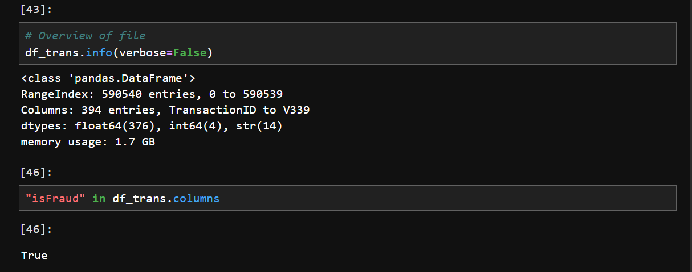

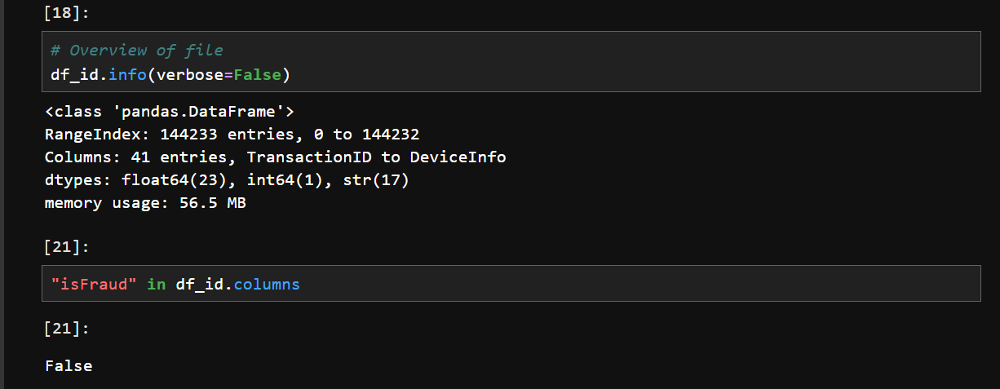

---

## 2. Detailed Data Profiling

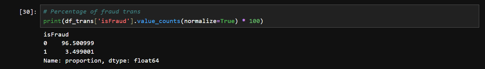
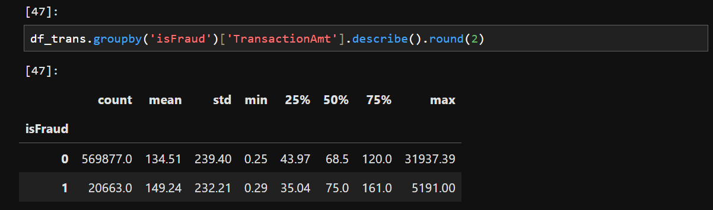

### 2.1. Target Risk Label Distribution (`isFraud`)
* Total transactions: **590,540**
  * Legitimate (`isFraud = 0`): **569,877** transactions (~**96.50%**)
  * Fraudulent (`isFraud = 1`): **20,663** transactions (~**3.50%**)

* **Key Characteristics**: 
  - **Severe Class Imbalance**: Fraud accounts for only ~3.50% of all transactions, which is typical for fraud detection datasets.
  - **Right-Skewed Transaction Amounts**: There is a large gap between the mean and the median (50th percentile). This indicates a heavily right-skewed, requiring careful consideration during downstream modeling and analytics.

### 2.2. Transaction & Identity Relationship

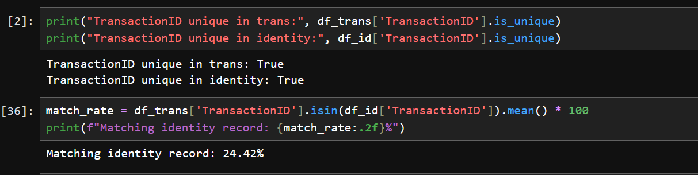

* **Join Key**: `TransactionID` (1:1 relationship).
* **Coverage**: Only approximately **24.4%** of records in `train_transaction` have a matching identity record in `train_identity`.
* **Business Context**: Only online purchases track digital identity details (device, IP, and browser); in-person card transactions do not.

### 2.3. Feature Groups & Technical Notes

1. **Identifier & Temporal Features**:
   * `TransactionID`: Unique primary key.
   * `TransactionDT`: Timedelta in seconds relative to a reference timestamp. Must be converted into `transaction_timestamp` and `transaction_date` during the dbt transformation stage to support date-based partitioning.
2. **Transaction & Card Attributes**:
   * `TransactionAmt`: Transaction amount.
   * `ProductCD`: Product code.
   * `card1` – `card6`:
     * `card1`, `card2`: Bank and branch identification codes.
     * `card4`: Card network / brand (e.g., Visa, Mastercard).
     * `card6`: Card category / funding type (e.g., credit, debit).

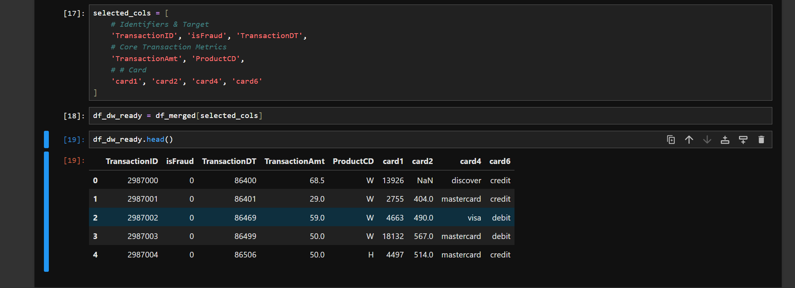

3. **Network & Geographic Attributes**:
   * `addr1`, `addr2`: Billing region / country codes.
   * `dist1`: Estimated geographic distance.
   * `P_emaildomain`, `R_emaildomain`: Purchaser and recipient email domain names.

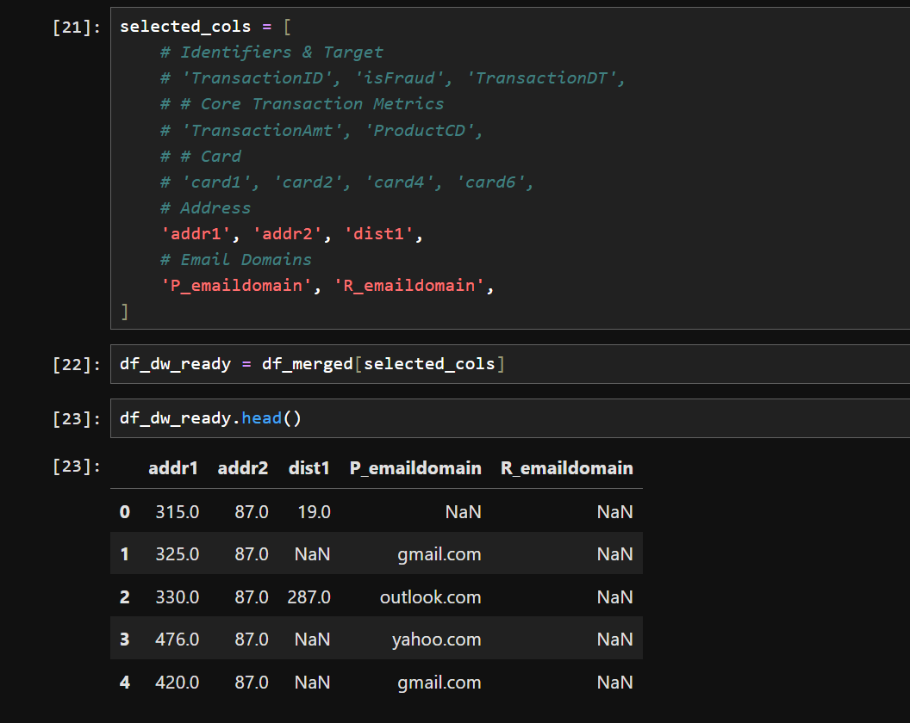

4. **Device Attributes (Identity)**:
   * `DeviceType`: Operating environment (desktop or mobile).
   * `DeviceInfo`: Device identification string (Windows, iOS Device, Samsung, etc.).
   * `id_30`, `id_31`: Operating system version and browser information.

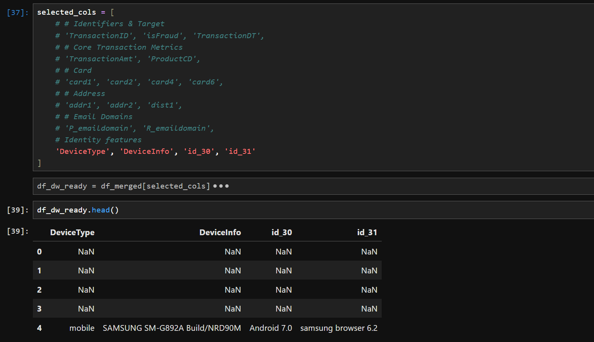

5. **Column Naming Quirks**:
   * In `train_identity.csv`, column names use underscores: `id_01` $\rightarrow$ `id_38`.
   * **dbt / Staging Rule**: Standardize column names (replacing hyphens `-` with underscores `_`) during ingestion and staging to ensure a consistent schema across environments.
  
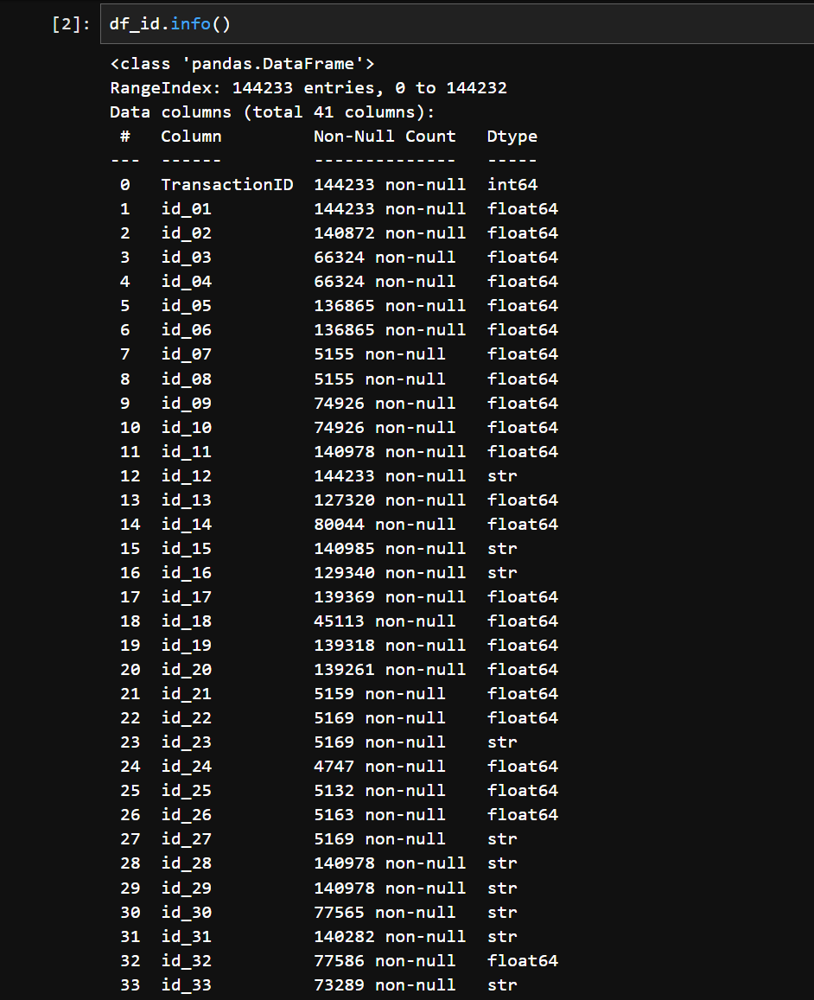
  
---

## 3. Data Warehouse & Transformation Architecture Decisions

### 3.1. Column Pruning (Lean Selection: ~20–22 Columns)

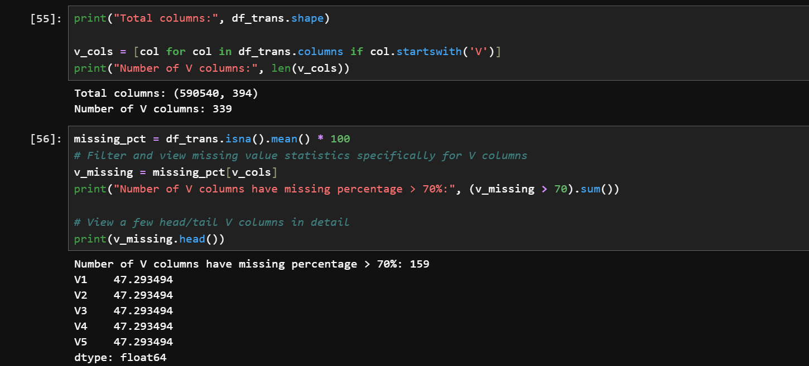

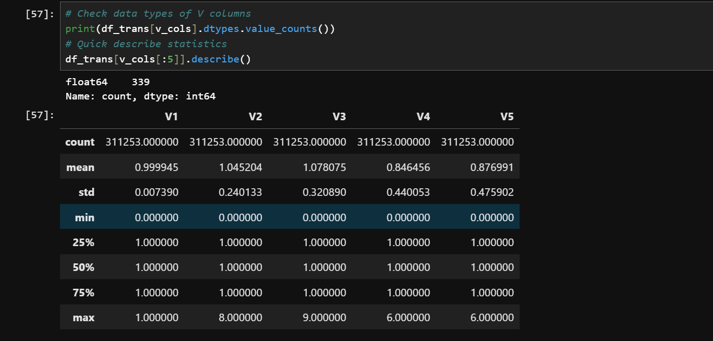

* The original dataset contains **over 400 columns**, mostly consisting of 339 anonymous features (`V1`–`V339`) with heavy missing values and limited business meaning.
* **Architecture Decision (Lean Approach)**: To minimize BigQuery scan costs and keep data pipelines simple, we only bring **~20–22 essential columns** into dbt staging and data marts:
  * **18 Raw Features** (selected during EDA):
    * **Keys & Target**: `TransactionID`, `TransactionDT`, `isFraud`
    * **Transaction Metrics**: `TransactionAmt`, `ProductCD`
    * **Card Info**: `card1`, `card2`, `card4`, `card6`
    * **Location & Contact**: `addr1`, `addr2`, `dist1`, `P_emaildomain`, `R_emaildomain`
    * **Device & Identity**: `DeviceType`, `DeviceInfo`, `id_30`, `id_31`
  * **3–4 Derived Features** (engineered during dbt transformation):
    * **Time Dimensions**: `transaction_timestamp`, `transaction_date`, `transaction_hour` (essential for BigQuery partitioning and hourly risk heatmaps).
    * **Amount Tiers**: `amount_bucket` (grouping transactions into spending tiers for risk segmentation).
* **Storage Strategy**:
  * **Raw Layer**: Store complete Parquet files on Google Cloud Storage (GCS) and query via BigQuery external tables.
  * **Staging & Marts**: Only transform and load the ~20–22 columns above to keep query costs near zero, while providing all necessary metrics for Looker Studio dashboards and Agentic AI summaries.

### 3.2. BigQuery Optimization Strategy (Partitioning & Clustering)
* **Partitioning**: 
  * Partition by transaction date: `transaction_date` (derived from `TransactionDT`).
  * Yields an estimated 80–90% reduction in query scan volume when filtering by date ranges on Looker Studio dashboards.
* **Clustering**:
  * Cluster tables by high-cardinality and frequent filter keys: `product_cd`, `card_type` (`card4`), and `is_fraud`.
  * Optimizes query performance and drastically reduces execution cost for risk segmentation and card-network breakdowns.

---

## 4. Next Action Items (Phase 2 Ingestion)

- [ ] Standardize the exploratory notebook [`notebooks/data_exploration.ipynb`](file:///d:/4.DE-zoomcamp/projects/fraud-risk-control-analytics/notebooks/data_exploration.ipynb) with core distribution charts.
- [ ] Develop `scripts/ingest_to_gcs.py`: Convert raw CSV files to Parquet (Snappy compression) and upload to the GCS bucket.
- [ ] Author the Airflow DAG `airflow/dags/risk_batch_ingest.py` to automate the batch ingestion pipeline into BigQuery.
