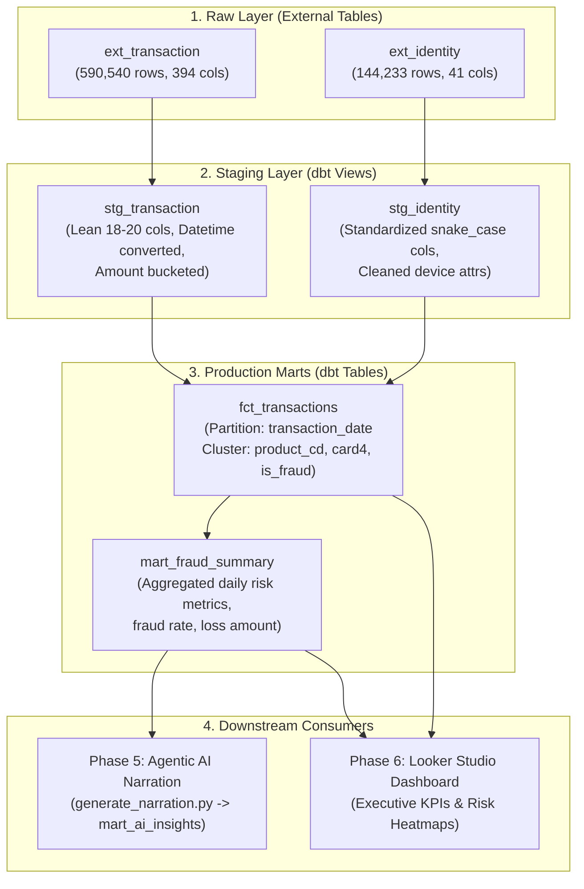

# Kế Hoạch Triển Khai Phase 3: Data Warehouse & Transformations (dbt)

> **Mục tiêu**: Xây dựng tầng Data Warehouse chuẩn hóa theo kiến trúc Medallion (Raw → Staging → Production Marts) trên Google BigQuery bằng `dbt` (`dbt-bigquery`), thực hiện Column Pruning (từ 400+ cột xuống ~20–22 cột), Partitioning & Clustering để tối ưu chi phí và phục vụ cho BI Dashboard (Looker Studio) cùng tầng Agentic AI Narration.

---

## 1. Bối Cảnh & Kiến Trúc Dữ Liệu (Architecture & Lineage)



---

## 2. Cấu Trúc Thư Mục dbt Dự Kiến

Dự án dbt sẽ được tổ chức độc lập trong thư mục `dbt/`:

```
dbt/
├── dbt_project.yml               # Cấu hình project, name, profile, materialization paths
├── profiles.yml                  # Cấu hình kết nối BigQuery (Dev / Prod profiles)
├── packages.yml                  # Khai báo dbt packages (dbt-utils nếu cần)
├── macros/
│   ├── generate_schema_name.sql  # Custom macro để giữ tên dataset staging / production chuẩn
│   └── get_amount_bucket.sql     # Macro phân nhóm giá trị giao dịch
├── models/
│   ├── sources.yml               # Khai báo BigQuery raw dataset & external tables
│   ├── staging/
│   │   ├── schema.yml            # Schema validation, docstrings & tests cho staging models
│   │   ├── stg_transaction.sql   # Pruning 394 cols -> ~18 cols, parse timestamp, format snake_case
│   │   └── stg_identity.sql      # Standardize column naming (id-01 -> id_01), device dimensions
│   └── marts/
│       ├── schema.yml            # Schema validation, tests (accepted_values, not_null, unique)
│       ├── fct_transactions.sql  # Denormalized Fact (Partitioned & Clustered)
│       └── mart_fraud_summary.sql # Aggregated risk metrics theo date, card, product, device
└── tests/
    ├── assert_valid_fraud_rate.sql      # Singular test: Tỷ lệ gian lận trong khoảng [0, 100%]
    └── assert_positive_amounts.sql      # Singular test: Số tiền giao dịch phải >= 0
```

---

## 3. Quy Cách Mô Hình Hóa Dữ Liệu (Data Modeling Specifications)

### 3.1. Staging Layer (`staging` dataset - Materialization: `view`)

| Model | Mục tiêu chính | Logic xử lý |
|---|---|---|
| `stg_transaction` | Thu gọn dữ liệu giao dịch từ 394 cột xuống ~18 cột nghiệp vụ cốt lõi | - Đổi tên cột sang `snake_case` chuẩn hóa.<br>- Ép kiểu dữ liệu (`INT64`, `FLOAT64`, `STRING`).<br>- Chuyển đổi `TransactionDT` (timedelta giây tính từ reference time `2017-12-01 00:00:00 UTC`) thành: `transaction_timestamp`, `transaction_date`, `transaction_hour`, `day_of_week`.<br>- Phân loại `amount_bucket`: Micro ($<10$), Low ($10-50$), Medium ($50-200$), High ($200-1000$), VIP ($>1000$). |
| `stg_identity` | Chuẩn hóa thông tin danh tính & thiết bị | - Đổi tên cột từ dấu gạch ngang sang gạch dưới: `id-01` $\rightarrow$ `id_01`, `id-31` $\rightarrow$ `id_31`, v.v.<br>- Chuẩn hóa các trường thiết bị: `device_type`, `device_info`, hệ điều hành và trình duyệt. |

#### Danh Sách Cột Tinh Gọn (~20–22 Cột):
1. **Khóa & Mục tiêu**: `transaction_id`, `transaction_timestamp`, `transaction_date`, `transaction_hour`, `day_of_week`, `is_fraud`
2. **Giao dịch**: `transaction_amt`, `amount_bucket`, `product_cd`
3. **Thẻ thanh toán**: `card1` (bank code), `card2` (branch), `card4` (card_network), `card6` (card_type)
4. **Địa lý & Liên hệ**: `addr1` (billing region), `addr2` (billing country), `dist1` (distance), `p_emaildomain`, `r_emaildomain`
5. **Thiết bị & Định danh**: `device_type`, `device_info`, `os_version` (`id_30`), `browser` (`id_31`)

### 3.2. Production Layer (`production` dataset - Materialization: `table`)

#### 1. Fact Table: `fct_transactions`
* **Mô tả**: Bảng sự kiện giao dịch đã được denormalize bằng cách `LEFT JOIN` giữa `stg_transaction` và `stg_identity` theo khóa `transaction_id`.
* **Cấu hình tối ưu hóa BigQuery**:
  * **Partitioning**: Theo `transaction_date` (giúp Looker Studio lọc theo khoảng ngày mà chỉ tốn scan chi phí cho đúng các partition được chọn, giảm 80–90% byte scan).
  * **Clustering**: Theo `product_cd`, `card_network` (`card4`), `is_fraud` (tăng tốc độ truy vấn khi dashboard lọc theo loại sản phẩm và phân loại rủi ro).

#### 2. Mart: `mart_fraud_summary`
* **Mô tả**: Bảng tổng hợp số liệu rủi ro định kỳ theo các chiều phân tích quan trọng.
* **Granularity**: `transaction_date`, `card_network`, `product_cd`, `device_type`.
* **Metrics (Chỉ số)**:
  * `total_transactions`: Tổng số lượng giao dịch.
  * `fraud_transactions`: Số lượng giao dịch gian lận (`COUNTIF(is_fraud = 1)`).
  * `fraud_rate`: Tỷ lệ gian lận (`SAFE_DIVIDE(fraud_transactions, total_transactions) * 100`).
  * `total_amount`: Tổng giá trị giao dịch ($).
  * `fraud_loss_amount`: Tổng số tiền bị gian lận chiếm đoạt ($).
  * `avg_transaction_amt`: Giá trị giao dịch trung bình ($).
* **Mục đích**: Là nguồn dữ liệu trực tiếp cho:
  * KPI Cards & Biểu đồ xu hướng rủi ro trên Looker Studio.
  * Tầng Agentic AI (`generate_narration.py`) query để đưa vào prompt tóm tắt rủi ro.

---

## 4. Kế Hoạch Thực Hiện Chi Tiết (Actionable Implementation Steps)

### Bước 1: Khởi tạo Project dbt & Cấu hình Kết nối
* Tạo cấu trúc thư mục `dbt/` trong root dự án.
* Viết file `dbt/dbt_project.yml` khai báo project `fraud_analytics`.
* Cấu hình `profiles.yml` (kết nối BigQuery thông qua `gcloud` ADC hoặc file service account key tại `credentials/`).
* Chạy `uv run dbt debug` kiểm tra kết nối tới BigQuery (`raw`, `staging`, `production`).

### Bước 2: Khai báo Source Catalog (`models/sources.yml`)
* Khai báo external table `raw.ext_transaction` và `raw.ext_identity`.
* Thiết lập freshness test và kiểm tra đọc dữ liệu thô.

### Bước 3: Phát triển Staging Models
* Xây dựng macro phân loại số tiền `get_amount_bucket.sql`.
* Viết SQL cho `models/staging/stg_transaction.sql`:
  * Trích xuất ~18 cột cần thiết.
  * Tính toán temporal dimensions (`transaction_timestamp`, `transaction_date`, `transaction_hour`, `day_of_week`).
* Viết SQL cho `models/staging/stg_identity.sql`:
  * Chuẩn hóa tên cột có dấu gạch ngang thành gạch dưới.
* Khai báo schema & generic tests (`unique`, `not_null`) trong `models/staging/schema.yml`.
* Thực thi `uv run dbt run --select staging` và xác thực kết quả.

### Bước 4: Xây dựng Production Marts
* Viết SQL cho `models/marts/fct_transactions.sql`:
  * Materialized dạng `table`.
  * Cấu hình BigQuery partition & cluster.
* Viết SQL cho `models/marts/mart_fraud_summary.sql`:
  * Tính toán đầy đủ các metrics tổng hợp rủi ro.
* Khai báo metadata, mô tả và relationship tests trong `models/marts/schema.yml`.
* Thực thi `uv run dbt run --select marts` và xác thực bảng trên BigQuery Console.

### Bước 5: Cài đặt Data Quality & Assertion Tests
* Thêm generic tests:
  * `unique` và `not_null` cho `transaction_id`.
  * `accepted_values` cho `is_fraud` (chỉ nhận `0` hoặc `1`).
  * `relationships` giữa `fct_transactions` và `stg_identity`.
* Viết 2 singular tests:
  * `tests/assert_valid_fraud_rate.sql`: Tỷ lệ rủi ro phải nằm từ 0% đến 100%.
  * `tests/assert_positive_amounts.sql`: Số tiền giao dịch phải lớn hơn 0.
* Chạy kiểm thử toàn diện: `uv run dbt test`.

### Bước 6: Khởi tạo Documentation & Lineage Graph
* Viết docstrings mô tả đầy đủ các cột và bảng trong `schema.yml`.
* Tạo dbt catalog: `uv run dbt docs generate`.
* Kiểm tra Data Lineage Graph để bảo đảm không có circular dependency.

### Bước 7: Tích hợp và Tự động hóa với Airflow (Optional Preparation - Lựa chọn B)
* **Quyết định**: Tạm thời duy trì dbt độc lập để ưu tiên chuyển sang **Phase 4: Streaming Pipeline**.
* **Kế hoạch thực hiện**: Sẽ tích hợp `dbt run` và `dbt test` vào Airflow DAG tổng thể (Master Pipeline) ở **Phase 5** (khi kết nối cùng task Agentic AI Narration) hoặc **Phase 7** (Final Polish).

---

## 5. Tiêu Chuẩn Nghiệm Thu (Acceptance Criteria & DoD)

- [x] Lệnh `dbt debug` trả về `All checks passed!`.
- [x] Số dòng trong `fct_transaction` khớp chính xác với bảng thô: **590,540 dòng**.
- [x] Bảng `fct_transaction` được partition theo `transaction_date` và clustered theo `product_code`, `card_network`, `is_fraud`.
- [x] Bảng `fraud_risk_summary` tổng hợp chính xác tỷ lệ gian lận toàn hệ thống (~**3.50%**).
- [x] 100% các bài test `dbt test` chạy thành công (0 test failures).
- [x] Chi phí scan query cho các báo cáo Looker Studio giảm tối thiểu **80%** so với query trực tiếp bảng raw.
- [x] Bộ tài liệu `dbt docs` sinh ra đầy đủ schema và lineage graph trực quan.
